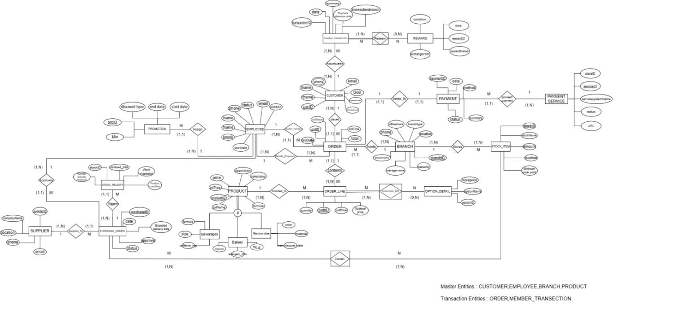
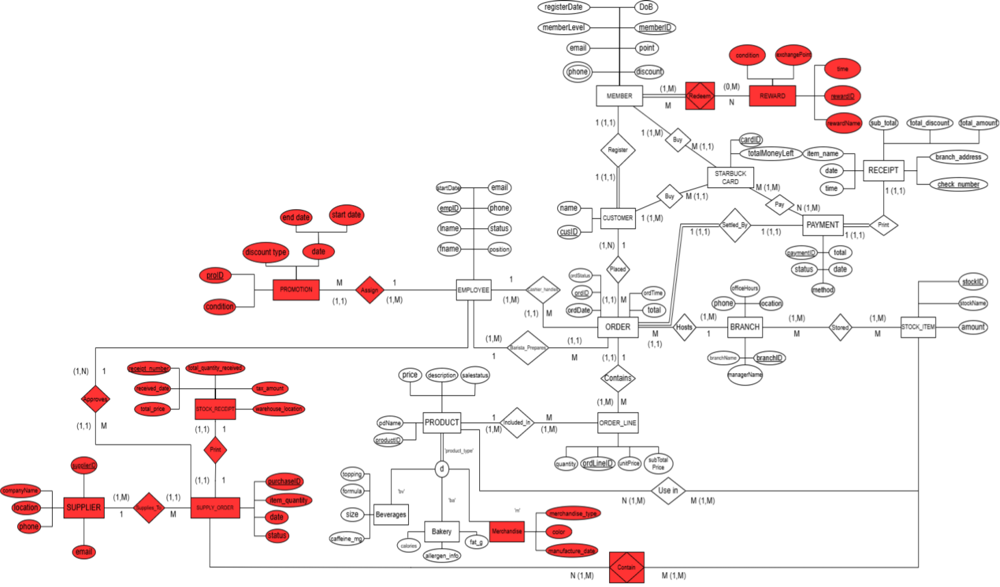
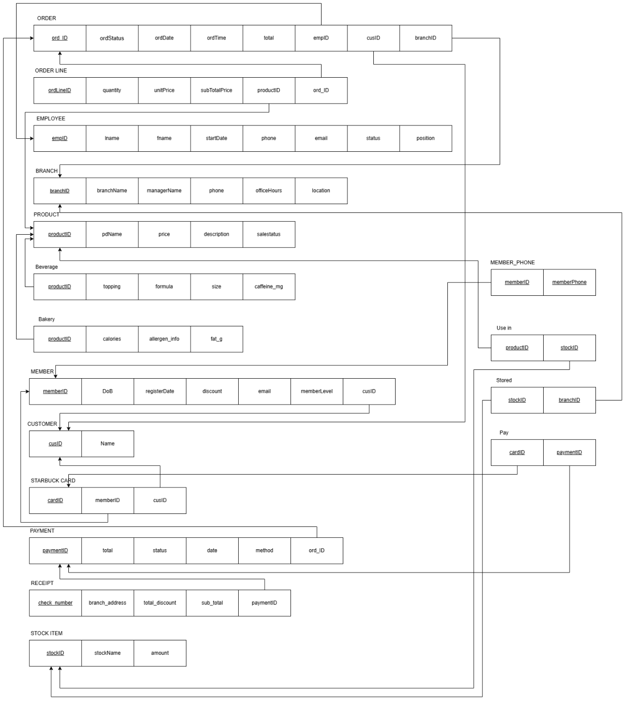

# Starbucks-Database-Systems

โครงงานการออกแบบฐานข้อมูลสำหรับ Starbucks เป็นส่วนหนึ่งของรายวิชา **ITDS 221 DATABASE MANAGEMENT SYSTEMS — ระบบการจัดการฐานข้อมูล (ทสวด 221)** คณะเทคโนโลยีสารสนเทศและการสื่อสาร มหาวิทยาลัยมหิดล

เนื้อหาในคลังนี้อ้างอิงจาก [รายงานฉบับสมบูรณ์ของโครงงานระยะที่ 2](docs/project-report.pdf) ครอบคลุมการวิเคราะห์กระบวนการทางธุรกิจ กฎเกณฑ์ทางธุรกิจ และการออกแบบฐานข้อมูลเชิงสัมพันธ์

## สมาชิกในกลุ่ม

รายชื่อและรหัสนักศึกษาตามหน้าปกรายงาน

| รหัสนักศึกษา | ชื่อ–นามสกุล |
| --- | --- |
| 6887010 | ชญานิน ปรีชาพานิช |
| 6887037 | พัฒนชัย เศวตบรรเจิด |
| 6887090 | อัณณ์ธิกานต์ เนียมแตง |
| 6887101 | ธัญยธร กิจสกุล |
| 6887113 | รวินันท์ บุญใส่ |

นักศึกษาชั้นปีที่ 1 คณะเทคโนโลยีสารสนเทศและการสื่อสาร มหาวิทยาลัยมหิดล

## อาจารย์ผู้สอน

- ผู้ช่วยศาสตราจารย์ ดร. ปรีชา ตั้งวรกิจถาวร
- ผู้ช่วยศาสตราจารย์ ดร. จิดาภา ไกรสังข์

## ระบบสารสนเทศที่ศึกษา

รายงานศึกษาระบบการสั่งซื้อเครื่องดื่มและระบบสมาชิก Starbucks Rewards โดยให้ลูกค้าสมัครสมาชิกเพื่อสะสมคะแนนจากการสั่งซื้อสินค้าและนำคะแนนมาแลกรางวัล

การวิเคราะห์กระบวนการทางธุรกิจแบ่งเป็น 3 กระบวนการ ตามรายงานหน้า 5–7

| กระบวนการ | ขั้นตอนหลัก |
| --- | --- |
| การสั่งซื้อเครื่องดื่ม | การเลือกเมนู → การสั่งซื้อสินค้า → การชำระเงิน → การจัดเตรียมเครื่องดื่ม → การรับสินค้า |
| การจัดการสินค้าคงคลัง | การตรวจสอบวัตถุดิบคงเหลือ → การบันทึกข้อมูลสินค้า → การสั่งซื้อวัตถุดิบเพิ่มเติม → การรับสินค้า → การปรับปรุงข้อมูลสต็อก |
| ระบบสมาชิก Starbucks Rewards | การสมัครสมาชิก → การบันทึกข้อมูลสมาชิก → การสะสมคะแนน → การตรวจสอบคะแนน → การแลกรางวัล |

## เนื้อหาการออกแบบฐานข้อมูล

| หัวข้อในรายงาน | หน้า |
| --- | --- |
| กฎเกณฑ์ทางธุรกิจ (Business Rules) | 8–16 |
| แผนภาพ ER/EER Diagram ในรูปแบบ Chen | 17 |
| แผนภาพ ERD/EERD ในรูปแบบ Chen ฉบับปรับปรุง พร้อมเหตุผลในการปรับปรุง | 18 |
| กระบวนการ Transform Mapping ทั้ง 8 ขั้นตอน | 19–24 |
| Relational Schema แสดงภาพรวมการออกแบบฐานข้อมูลเชิงสัมพันธ์ | 25 |
| Relational Schema ในรูปของนอร์มัลฟอร์มที่ 3 (Third Normal Form) | 26 |
| Data Dictionary แสดงโครงสร้างและคุณสมบัติของ Attributes | 27–30 |
| การชี้แจงการใช้ Generative AI และแหล่งอ้างอิง | 31 |

## โครงสร้างไฟล์

```text
starbucks-database-system/
├── README.md
├── docs/
│   └── project-report.pdf
├── diagrams/
│   ├── erd.png
│   ├── eerd-improved.png
│   └── relational-schema.png
├── database/
│   ├── schema.sql
│   └── sample-data.sql
├── sql/
│   ├── README.md
│   └── schema.sql
└── assets/
    └── preview.png
```

| ไฟล์ | รายละเอียด |
| --- | --- |
| [project-report.pdf](docs/project-report.pdf) | รายงานต้นฉบับ คงเนื้อหาและไฟล์เดิมโดยไม่มีการแก้ไข |
| [erd.png](diagrams/erd.png) | ภาพ ER/EER Diagram จากรายงานหน้า 17 |
| [eerd-improved.png](diagrams/eerd-improved.png) | ภาพ ERD/EERD ฉบับปรับปรุงจากรายงานหน้า 18 |
| [relational-schema.png](diagrams/relational-schema.png) | ภาพ Relational Schema จากรายงานหน้า 25 |
| [schema.sql](database/schema.sql) | ข้อความ Data Dictionary ที่ดึงจากรายงานหน้า 27–30 เก็บเป็นคอมเมนต์ SQL |
| [sample-data.sql](database/sample-data.sql) | คอมเมนต์ระบุว่าในรายงานไม่มีข้อมูลตัวอย่างหรือคำสั่ง INSERT |
| [สคริปต์ MySQL](sql/schema.sql) | คำสั่งสร้างตารางจาก Data Dictionary พร้อม [วิธีใช้งานและข้อจำกัด](sql/README.md) |
| [preview.png](assets/preview.png) | สำเนาภาพ ER/EER Diagram สำหรับแสดงตัวอย่าง |

รายงานไม่มีคำสั่ง SQL สำหรับสร้างตารางหรือข้อมูลตัวอย่าง ไฟล์ในโฟลเดอร์ `database/` ยังคงเป็นคอมเมนต์อ้างอิงจากรายงาน ส่วน [sql/schema.sql](sql/schema.sql) เป็นสคริปต์ MySQL ที่เขียนขึ้นจาก Data Dictionary โดยไม่เพิ่มข้อมูลตัวอย่าง ดูวิธีรันและจุดที่ข้อมูลต้นฉบับไม่สอดคล้องกันได้ที่ [คู่มือสคริปต์ MySQL](sql/README.md)

## ตัวอย่างแผนภาพ

### ER/EER Diagram



### ERD/EERD ฉบับปรับปรุง



### Relational Schema



## แหล่งอ้างอิงตามรายงาน

- [Starbucks](https://www.starbucks.com)
- [Starbucks ประเทศไทย](https://www.starbucks.co.th)
- [Our Original Store](https://about.starbucks.com/history/our-original-store/)
